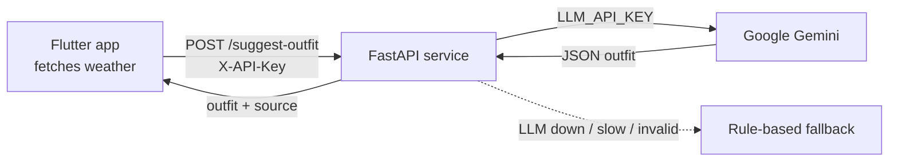

# Weathera AI Service

[](https://github.com/najatish78/weathera-ai-service/actions/workflows/tests.yml)


The backend of [**Weathera**](https://github.com/najatish78/weathera), a Flutter weather app that tells you what to wear.
The app sends the forecast and the user's profile; this service asks an LLM (Google Gemini) for an outfit
and returns structured JSON that the app renders.

**Live:** https://weathera-ai-service.onrender.com · [API docs](https://weathera-ai-service.onrender.com/docs)
<sub>Free instance: the first request after ~15 idle minutes can take up to a minute while it wakes up.</sub>

## Why a backend?

Anything shipped inside an APK or IPA can be extracted. The LLM key therefore lives only on this server.
The app authenticates with its own key (`X-API-Key`), which the server can rotate or rate-limit on its own.



## API

`POST /suggest-outfit` with header `X-API-Key: <key>`

```json
{
  "weather": {
    "temp_min": 7, "temp_max": 12, "feels_like": 5,
    "rain_chance": 80, "wind_speed": 6, "condition": "Rain"
  },
  "profile": {
    "age": 28, "gender": "male", "height_cm": 178, "weight_kg": 75,
    "cold_sensitivity": "high", "style": "casual"
  },
  "lang": "en"
}
```

```json
{
  "top": "Thick wool sweater",
  "bottom": "Warm jeans",
  "shoes": "Waterproof boots",
  "jacket": "Lined rain jacket",
  "umbrella": true,
  "sunscreen": false,
  "reason": "Cold and rainy, and you feel the cold easily: layer up and keep dry.",
  "source": "llm"
}
```

| Status | Meaning |
|---|---|
| `200` | Outfit returned. `source` is `llm`, or `fallback` when the rules answered |
| `401` | Missing or wrong `X-API-Key` |
| `422` | Invalid input, e.g. `rain_chance` outside 0–100 or an unknown `condition` |

`condition` takes OpenWeather's `weather[0].main` values. `rain_chance` is a whole percent (the app sends `pop × 100`).
Answers are in English or Arabic (`lang`).

## Design decisions

- **Always answer.** If the LLM fails, times out or returns invalid JSON, the repository falls back to
  rules. The app always gets an outfit, and `source` makes the fallback visible.
- **LLM output is untrusted input.** The reply is validated against the same Pydantic model as the rules,
  with length caps on every text field. `max_tokens` bounds the cost of a single call.
- **Closed inputs against prompt injection.** User-controlled fields are enums or bounded numbers, so no
  free text reaches the prompt.
- **Ordered timeouts.** LLM 8 s < app 15 s, with no automatic retries, so the fallback arrives before the
  app gives up and a slow call is never billed twice.
- **Stateless.** No per-user state in memory, so instances can restart or scale freely.

## Architecture

Clean Architecture, mirroring the Flutter app so both sides read the same way:

```
app/
├── core/             settings (.env), API-key check
├── di/               dependency wiring (FastAPI Depends, like get_it)
└── features/outfit/
    ├── presentation/ routes
    ├── domain/       params, repository contract, use case
    └── data/         Gemini + rules datasources, models, repository impl
```

## Tech stack

Python 3.14 · FastAPI · Pydantic v2 · pydantic-settings · OpenAI SDK (Gemini's OpenAI-compatible endpoint) ·
pytest · GitHub Actions · Render (Blueprint)

## Run locally

```bash
python3 -m venv .venv
source .venv/bin/activate
pip install -r requirements.txt
cp .env.example .env        # then add your Gemini key from https://aistudio.google.com/apikey
fastapi dev app/main.py     # http://127.0.0.1:8000/docs
```

## Tests

```bash
pytest
```

The tests use a fake LLM client and never read your `.env`, so they run anywhere without keys.
CI runs them on every push and pull request.

## Deploy

[`render.yaml`](render.yaml) describes the service as a Render Blueprint: Dashboard → New → Blueprint → this repo,
then paste `LLM_API_KEY`. Render generates `APP_API_KEY` and redeploys on every merge to `main`.

## Roadmap

- Fail-fast settings check at startup and secrets as `SecretStr`
- One-line structured logs without personal data
- Per-user auth (JWT) and rate limiting with Redis
- Response caching by weather bucket to cut LLM cost
- Rules own the clear-cut fields (umbrella, sunscreen); the LLM owns style
- Monitoring of fallback rate, latency and cost
